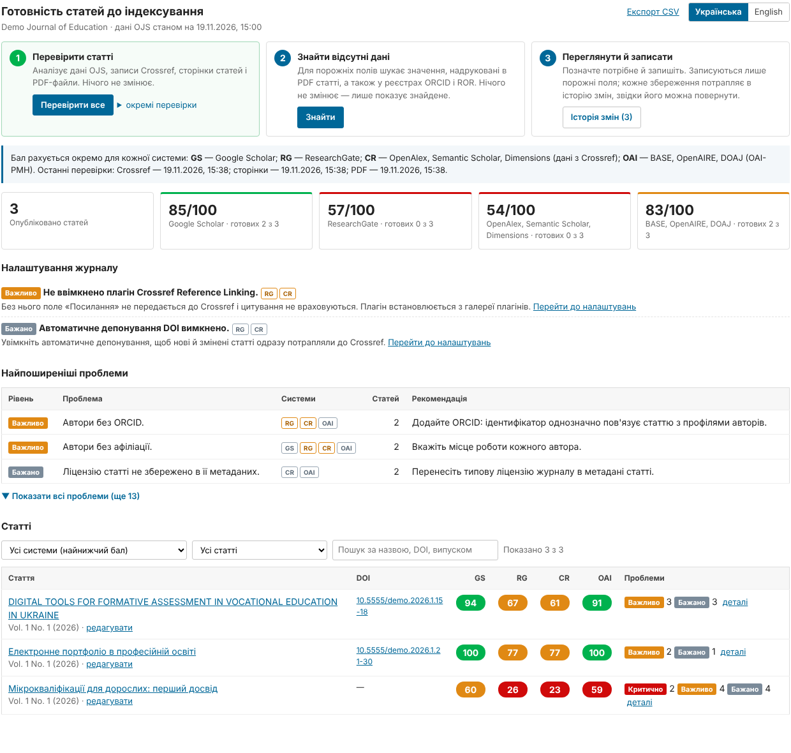
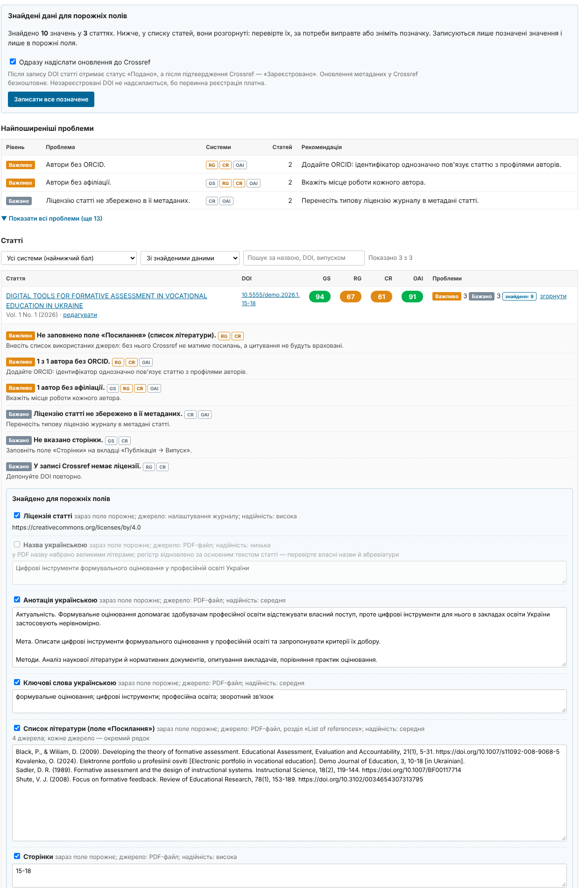
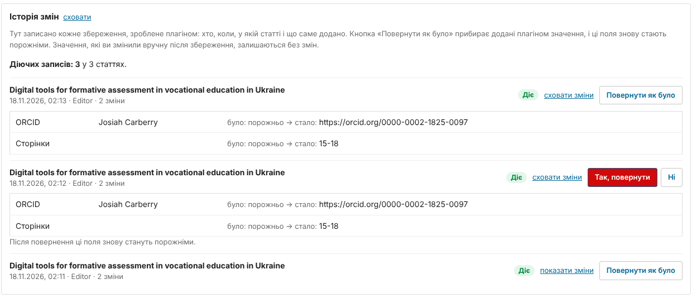
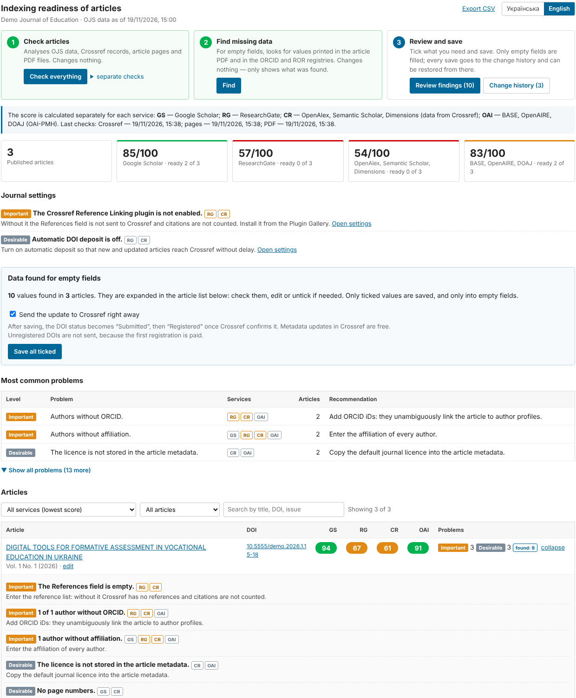

# Indexing Readiness for OJS 3.5

[](https://pkp.sfu.ca/software/ojs/)
[](LICENSE)
[](#interface-languages)

**English** · [Українська](README.uk.md)

A generic plugin for [Open Journal Systems](https://pkp.sfu.ca/software/ojs/) 3.5. It checks how ready every published article is for scholarly indexing services, explains what is missing, and helps the editor fill **empty** metadata fields with data that is actually **printed in the article PDF** or recorded in the **ORCID** and **ROR** registries. Nothing is written without the editor's confirmation, and every save can be restored.

The plugin adds a tab to **Settings → Distribution → Indexing readiness**.



---

## Contents

- [Why](#why)
- [What the plugin checks](#what-the-plugin-checks)
- [How to work with it](#how-to-work-with-it)
- [Where the data comes from](#where-the-data-comes-from)
- [Saving, Crossref deposit and fees](#saving-crossref-deposit-and-fees)
- [Change history and restore](#change-history-and-restore)
- [Installation](#installation)
- [Requirements](#requirements)
- [Security and privacy](#security-and-privacy)
- [Limitations](#limitations)
- [Interface languages](#interface-languages)
- [Project structure](#project-structure)
- [Changelog](#changelog)
- [License](#license)

## Why

Indexing services do not read an OJS journal in the same way:

| Label | Services | Where they take data from |
|---|---|---|
| **GS** | Google Scholar | `citation_*` meta tags on the article page and an openly accessible PDF |
| **RG** | ResearchGate | Crossref metadata and its own crawler |
| **CR** | OpenAlex, Semantic Scholar, Dimensions | Crossref metadata |
| **OAI** | BASE, OpenAIRE, DOAJ | the OAI-PMH interface of the journal |

An article can be perfectly visible in Google Scholar and still reach Crossref without an abstract, references or ORCID iDs. The plugin therefore scores each article **separately for each group of services** (0–100, “ready” from 85) and shows which problem affects which service.

## What the plugin checks

**Journal settings.** Site and article access restrictions, publishing mode, English as a metadata language, the Google Scholar Indexing, Crossref Manager and Crossref Reference Linking plugins, DOI settings and registration agency, automatic deposit, ISSN, publisher, OAI-PMH, default licence, the local ROR registry, `robots.txt`.

**Each article in OJS.** DOI and its deposit status, PDF galley, open access, titles, abstracts and keywords (including English), the References field, authors (ORCID, affiliation, ROR, English spelling of the name), licence, pages.

**Crossref record.** Whether the DOI exists in Crossref and whether the abstract, references, ORCID iDs, affiliations, licence and full-text link actually reached it.

**Article page and OAI-PMH.** HTTP status, `noindex`, the `citation_title`, `citation_author`, `citation_pdf_url` and `citation_doi` tags, `robots.txt` rules, the OAI-PMH `Identify` response.

**PDF file.** Text layer (scanned pages), file size over 5 MB, a whole issue in one file, the article title on the first page.

Every problem comes with a severity (critical, important, desirable), the services it affects and a concrete recommendation. The block **Most common problems** shows the three problems affecting the largest number of articles and expands to the full list.

## How to work with it

The tab is organised as three steps.

1. **Check articles.** Analyses OJS data, Crossref records, article pages and PDF files and calculates the scores. Changes nothing. Separate checks (Crossref, pages and OAI, PDF) are available under “separate checks”.
2. **Find missing data.** Looks for values for **empty** fields only — in the article PDF and in the ORCID and ROR registries. Changes nothing: the findings are expanded under each article.
3. **Review and save.** Tick what you need, edit the text if necessary and save. Each save is recorded in the **change history**.



## Where the data comes from

The plugin **does not invent data**. It takes only what is printed in the article, recorded in the ORCID or ROR registry, or set in the journal settings. If a value is not available anywhere, the field stays empty and is reported as a problem.

| Field | Source |
|---|---|
| Title, abstract, keywords (English and Ukrainian) | Article PDF; structured abstracts keep their paragraphs |
| References | Article PDF; if the article has two lists (for example, the original list and a transliterated *References*), you choose which one to use; one reference per line |
| Pages | Article PDF: the imprint line (“pp. 135–144”) and the page numbers in running heads or footers |
| ORCID iD | Article PDF, only if the name in the ORCID record matches the author |
| Author's email | Article PDF (author information) |
| Affiliation | Article PDF (author information), only when the author has no affiliation in OJS. The organisation name is taken only when it is printed as a separate item; a fragment such as “Senior Researcher of the Department of … of the Institute …” is skipped, because changing its grammatical form would mean altering the text |
| Name in English | ORCID record or the English part of the article; **no transliteration** |
| ROR ID | ROR registry: only the match chosen by ROR itself and only if the organisation exists in the local ROR registry of OJS |
| Article licence | Default licence of the journal |

Each proposal is shown with its source and reliability. Low-reliability proposals — for example, a title set in capitals in the PDF, whose letter case is restored from the article text — are **not ticked** by default.

## Saving, Crossref deposit and fees

- Values are written into the **published** version of the article only after confirmation.
- The server checks every field again: **a filled field is never overwritten**.
- After saving, the article is reindexed for the OJS search.

The option **“Send the update to Crossref right away”** (on by default) is shown above the “Save all ticked” button and under the findings of each article:

- **On:** the article's DOIs are queued for deposit. The DOI status becomes *Submitted* and then *Registered* once Crossref confirms it. OJS processes the job queue itself (`job_runner` in `config.inc.php`).
- **Off:** previously registered DOIs get the *Needs Sync* status and can be deposited later in the DOIs section or by automatic deposit.
- DOIs with the status *Unregistered* are **never sent** by the plugin. A first registration is a paid operation, so it stays the editor's decision in the DOIs section. Updating the metadata of an already registered DOI is free of charge in Crossref ([Crossref documentation](https://www.crossref.org/documentation/register-maintain-records/)).

## Change history and restore



- Each entry shows the article, date, user, number of changes and its status: **Active** or **Restored**.
- **Show changes** lists what exactly was added: “before: empty → after: …”.
- **Restore previous state**, after a second confirmation, removes the values added by the plugin, so these fields become empty again. Values that were edited manually after the save are left untouched.
- The history is stored in `files_dir/indexingReadiness/changes-<journal id>.json`, outside the web root. OJS also records the metadata change in the article's event log.

## Installation

**From a release (recommended)**

1. Open the [latest release](../../releases/latest) and download **Source code (tar.gz)**. OJS 3.5 finds `version.xml` inside the archive and installs the plugin into `plugins/generic/indexingReadiness` regardless of the archive folder name.
2. In OJS: **Settings → Website → Plugins → Upload A New Plugin** and select the archive.
3. Enable **Indexing Readiness** among the generic plugins.
4. Open **Settings → Distribution → Indexing readiness**.

To update, open the plugin's menu in the plugin list, choose **Upgrade Plugin** and upload the new archive. The change history is preserved.

**From source**

```bash
cd /path/to/ojs/plugins/generic
git clone https://github.com/Radkevych/indexingReadiness.git
cd /path/to/ojs
php lib/pkp/tools/installPluginVersion.php plugins/generic/indexingReadiness/version.xml
```

## Requirements

- OJS **3.5** (the code was checked against OJS 3.5.0-5).
- A modern browser: PDF analysis runs in the browser with [pdf.js](https://mozilla.github.io/pdf.js/).
- For ROR proposals: the local ROR registry filled by the OJS scheduled task that updates the ROR dataset.
- For references in Crossref: the [Crossref Reference Linking](https://github.com/pkp/crossrefReferenceLinking) plugin.

## Security and privacy

- The report and all write operations are available only to journal managers with settings access and to site administrators. Write requests are protected by the session CSRF token.
- PDF files are read through a dedicated route of the plugin, so the analysis does **not** count as downloads in the usage statistics.
- Requests to the public Crossref, ORCID and ROR APIs are sent by the browser. For Crossref, the journal contact email is passed as the `mailto` parameter recommended by Crossref.
- Check results are cached in the browser for 24 hours; parsed PDF text is kept in memory only.

## Limitations

- PDF parsing relies on the usual structure of an article (headings such as *Abstract*, *Анотація*, *Реферат*, *Keywords*, *Ключові слова*, *References*, *Список використаних джерел*). Older two-column layouts give weaker results, so proposals must be reviewed.
- The plugin cannot confirm that an article is already indexed by a particular service; it shows whether the journal has done everything on its side.
- Bot protection at the hosting or CDN level cannot be detected from the browser.

## Interface languages

Ukrainian and English. The language follows the OJS interface language and can be switched with the **Українська / English** buttons in the report header; the choice is remembered in the browser. Server messages are translated through the OJS locale files (`locale/uk`, `locale/en`).



## Project structure

```text
IndexingReadinessPlugin.php     tab in Settings → Distribution, routing, assets
IndexingReadinessHandler.php    report page, data, PDF access, save, history, restore
classes/ReadinessCollector.php  journal settings and article metadata (JSON)
classes/ChangeApplier.php       confirmed writes (empty fields only), restore, Crossref deposit
classes/ChangeLog.php           change history with previous values
js/report.js                    checks, scores, proposals, interface (Ukrainian / English)
js/sources.js                   PDF parsing, ORCID and ROR lookups
lib/pdfjs/                      pdf.js 4.10.38 (Mozilla, Apache License 2.0)
locale/                         Ukrainian and English messages
templates/report.tpl            report page
```

## Changelog

**2.2.1** — more accurate restoring of letter case in titles; keyword lists that continue on the next line are read completely.

**2.2.0** — three-step workflow; *Find missing data* instead of *Prepare additions*; redesigned change history with details and two-step *Restore previous state*; affiliation, email and pages from the PDF; transliteration removed.

**2.1.0** — English interface; *Most common problems* shows the top three with an expandable list; *Send the update to Crossref right away* option; unregistered DOIs are not deposited.

**2.0.0** — scores per service (Google Scholar, ResearchGate, Crossref-based aggregators, OAI-PMH); PDF, OAI-PMH and page checks; confirmed filling of empty metadata from PDFs, ORCID and ROR; change history and restore.

**1.0.0** — ResearchGate readiness report.

## License

[GNU General Public License v3.0](LICENSE). The bundled pdf.js is distributed under the [Apache License 2.0](lib/pdfjs/LICENSE).

Author: **Oleksandr Radkevych**.
