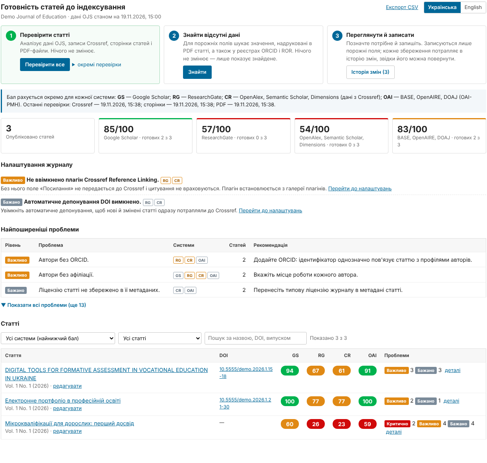
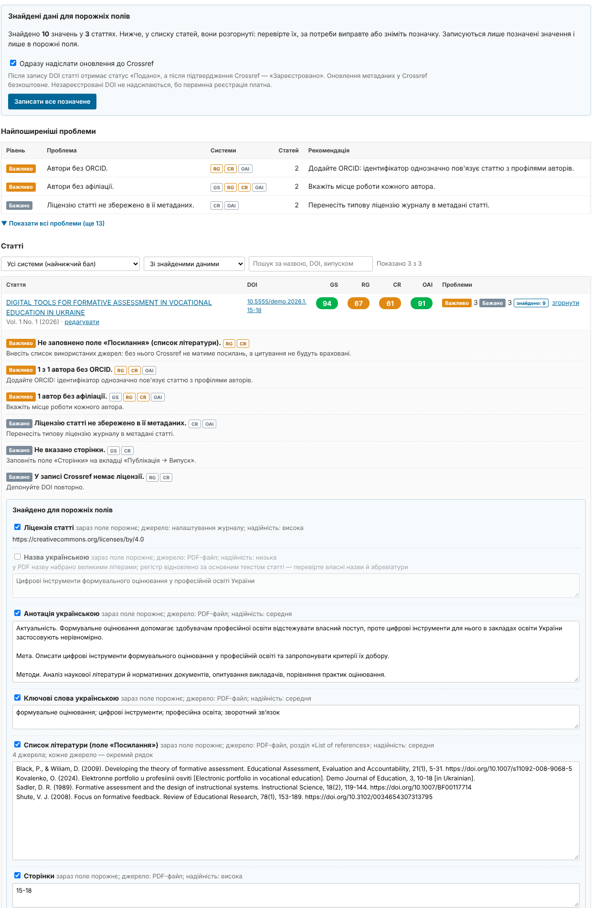
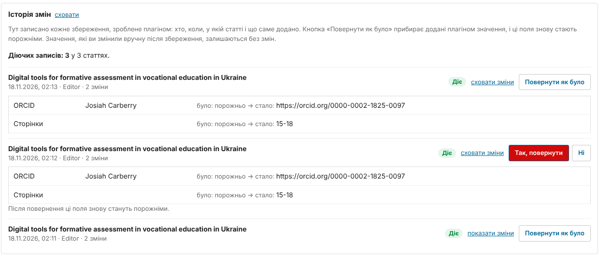

# Готовність до індексування для OJS 3.5

[](https://pkp.sfu.ca/software/ojs/)
[](LICENSE)
[](#мови-інтерфейсу)

[English](README.md) · **Українська**

Загальний плагін для [Open Journal Systems](https://pkp.sfu.ca/software/ojs/) 3.5. Він перевіряє, наскільки кожна опублікована стаття готова до індексування в наукових системах, пояснює, чого бракує, і допомагає редакторові заповнити **порожні** поля метаданих даними, які справді **надруковано в PDF статті** або записано в реєстрах **ORCID** і **ROR**. Без підтвердження редактора нічого не записується, а кожне збереження можна повернути.

Плагін додає вкладку **«Налаштування → Розповсюдження → Готовність до індексування»**.



---

## Зміст

- [Навіщо](#навіщо)
- [Що перевіряє плагін](#що-перевіряє-плагін)
- [Як працювати](#як-працювати)
- [Звідки беруться дані](#звідки-беруться-дані)
- [Запис, депонування в Crossref і оплата](#запис-депонування-в-crossref-і-оплата)
- [Історія змін і повернення](#історія-змін-і-повернення)
- [Встановлення](#встановлення)
- [Вимоги](#вимоги)
- [Безпека і приватність](#безпека-і-приватність)
- [Обмеження](#обмеження)
- [Мови інтерфейсу](#мови-інтерфейсу)
- [Будова проєкту](#будова-проєкту)
- [Історія версій](#історія-версій)
- [Ліцензія](#ліцензія)

## Навіщо

Системи індексування читають журнал на OJS по-різному:

| Позначка | Системи | Звідки беруть дані |
|---|---|---|
| **GS** | Google Scholar | мітки `citation_*` на сторінці статті й PDF у відкритому доступі |
| **RG** | ResearchGate | метадані Crossref і власний пошуковий робот |
| **CR** | OpenAlex, Semantic Scholar, Dimensions | метадані Crossref |
| **OAI** | BASE, OpenAIRE, DOAJ | протокол OAI-PMH журналу |

Стаття може бути добре видимою в Google Scholar і водночас потрапити до Crossref без анотації, списку літератури чи ORCID. Тому плагін оцінює кожну статтю **окремо для кожної групи систем** (від 0 до 100; від 85 — «готова») і показує, на яку систему впливає кожна проблема.

## Що перевіряє плагін

**Налаштування журналу.** Обмеження доступу до сайту й статей, режим публікації, англійська як мова метаданих, плагіни індексування в Google Академії, менеджера Crossref і Crossref Reference Linking, налаштування DOI та агент реєстрації, автоматичне депонування, ISSN, видавець, OAI-PMH, типова ліцензія, локальний реєстр ROR, `robots.txt`.

**Кожна стаття в OJS.** DOI і статус депонування, PDF-гранка, відкритий доступ, назви, анотації й ключові слова (зокрема англійською), поле «Посилання», автори (ORCID, афіліація, ROR, англомовне написання імені), ліцензія, сторінки.

**Запис у Crossref.** Чи є DOI у Crossref і чи дійшли туди анотація, список літератури, ORCID, афіліації, ліцензія та посилання на повний текст.

**Сторінка статті й OAI-PMH.** Код відповіді, `noindex`, мітки `citation_title`, `citation_author`, `citation_pdf_url` і `citation_doi`, правила `robots.txt`, відповідь OAI-PMH на запит `Identify`.

**PDF-файл.** Текстовий шар (скановані сторінки), розмір понад 5 МБ, весь випуск в одному файлі, назва статті на першій сторінці.

Для кожної проблеми вказано рівень (критично, важливо, бажано), системи, яких вона стосується, і конкретну рекомендацію. Блок **«Найпоширеніші проблеми»** показує три проблеми, що стосуються найбільшої кількості статей, і розгортається до повного списку.

## Як працювати

Вкладка побудована як три кроки.

1. **Перевірити статті.** Аналізує дані OJS, записи Crossref, сторінки статей і PDF-файли та ставить бали. Нічого не змінює. Окремі перевірки (Crossref, сторінки й OAI, PDF) сховано під посиланням «окремі перевірки».
2. **Знайти відсутні дані.** Шукає значення лише для **порожніх** полів — у PDF статті та в реєстрах ORCID і ROR. Нічого не змінює: знайдене розгорнуто під кожною статтею.
3. **Переглянути й записати.** Позначте потрібне, за потреби виправте текст і запишіть. Кожне збереження потрапляє в **історію змін**.



## Звідки беруться дані

Плагін **не вигадує даних**. Він бере лише те, що надруковано в статті, записано в реєстрах ORCID чи ROR або вказано в налаштуваннях журналу. Якщо значення ніде немає, поле лишається порожнім і позначається як проблема.

| Поле | Джерело |
|---|---|
| Назва, анотація, ключові слова (українською та англійською) | PDF статті; структурована анотація зберігає абзаци |
| Поле «Посилання» (список літератури) | PDF статті; якщо в статті два списки (наприклад, оригінальний і транслітерований *References*), можна обрати потрібний; кожне джерело — окремий рядок |
| Сторінки | PDF статті: вихідні дані («рр. 135–144») і номери сторінок у колонтитулах |
| ORCID | PDF статті, лише якщо ім'я в профілі ORCID збігається з автором |
| Email автора | PDF статті (відомості про автора) |
| Місце роботи | PDF статті (відомості про автора), лише якщо в OJS афіліації немає. Назву установи беруть лише тоді, коли її надруковано окремо; фрагмент на кшталт «старший науковий співробітник відділу … Інституту …» пропускається, бо зміна відмінка означала б зміну тексту |
| Ім'я англійською | профіль ORCID або англомовна частина статті; **транслітерації немає** |
| ROR | реєстр ROR: лише запис, обраний самим ROR як збіг, і лише якщо установа є в локальному реєстрі ROR вашої OJS |
| Ліцензія статті | типова ліцензія журналу |

Кожну пропозицію показано з джерелом і надійністю. Пропозиції з низькою надійністю, наприклад назву, набрану в PDF великими літерами (регістр відновлено за основним текстом статті), за замовчуванням **не позначено**.

## Запис, депонування в Crossref і оплата

- Значення записуються в **опубліковану** версію статті лише після підтвердження.
- Сервер повторно перевіряє кожне поле: **заповнене поле ніколи не перезаписується**.
- Після запису статтю переіндексовано для пошуку в OJS.

Позначка **«Одразу надіслати оновлення до Crossref»** (за замовчуванням увімкнена) розміщена над кнопкою «Записати все позначене» і під знайденими даними кожної статті:

- **Увімкнено:** DOI статті ставляться в чергу на депонування. Статус DOI стає «Подано», а після підтвердження Crossref — «Зареєстровано». Чергу завдань OJS виконує сама (параметр `job_runner` у `config.inc.php`).
- **Вимкнено:** раніше зареєстровані DOI отримують статус «Потребує синхронізації»; їх можна надіслати пізніше в розділі «DOI» або автоматичним депонуванням.
- DOI зі статусом «Не зареєстровано» плагін **не надсилає ніколи**. Первинна реєстрація платна, тож рішення про неї лишається за редактором у розділі «DOI». Оновлення метаданих уже зареєстрованого DOI в Crossref безкоштовне ([документація Crossref](https://www.crossref.org/documentation/register-maintain-records/)).

## Історія змін і повернення



- У кожному записі видно статтю, дату, користувача, кількість змін і статус: **«Діє»** або **«Повернуто»**.
- **«Показати зміни»** розкриває, що саме додано: «було: порожньо → стало: …».
- **«Повернути як було»** після повторного підтвердження прибирає додані плагіном значення, і ці поля знову стають порожніми. Значення, змінені вручну після збереження, залишаються без змін.
- Історія зберігається у файлі `files_dir/indexingReadiness/changes-<id журналу>.json`, поза вебкоренем. Крім того, OJS сам фіксує зміну метаданих у журналі подій статті.

## Встановлення

**З випуску (рекомендовано)**

1. Завантажте `indexingReadiness-<версія>.tar.gz` у розділі [Releases](../../releases).
2. В OJS: **«Налаштування → Вебсайт → Плагіни → Завантажити новий плагін»** і оберіть архів.
3. Увімкніть **«Готовність до індексування»** серед загальних плагінів.
4. Відкрийте **«Налаштування → Розповсюдження → Готовність до індексування»**.

Щоб оновити, відкрийте меню плагіна в списку плагінів, оберіть **«Оновити плагін»** і завантажте новий архів. Історія змін зберігається.

**З вихідного коду**

```bash
cd /шлях/до/ojs/plugins/generic
git clone https://github.com/Radkevych/indexingReadiness.git
cd /шлях/до/ojs
php lib/pkp/tools/installPluginVersion.php plugins/generic/indexingReadiness/version.xml
```

## Вимоги

- OJS **3.5** (код звірено з OJS 3.5.0-5).
- Сучасний браузер: розбір PDF виконується в браузері за допомогою [pdf.js](https://mozilla.github.io/pdf.js/).
- Для пропозицій ROR: локальний реєстр ROR, який заповнює заплановане завдання OJS з оновлення реєстру ROR.
- Для передавання списків літератури до Crossref: плагін [Crossref Reference Linking](https://github.com/pkp/crossrefReferenceLinking).

## Безпека і приватність

- Звіт і всі операції запису доступні лише менеджерам журналу з доступом до налаштувань і адміністраторам сайту. Запити на запис захищено токеном безпеки сесії.
- PDF-файли читаються через окремий шлях плагіна, тож аналіз **не** враховується як завантаження в статистиці використання.
- Запити до відкритих API Crossref, ORCID і ROR надсилає браузер. Для Crossref контактну адресу журналу передано в параметрі `mailto`, як радить Crossref.
- Результати перевірок зберігаються в браузері 24 години; розібраний текст PDF зберігається лише в пам'яті сторінки.

## Обмеження

- Розбір PDF спирається на типову будову статті (заголовки *Abstract*, «Анотація», «Реферат», *Keywords*, «Ключові слова», *References*, «Список використаних джерел»). Для старих двоколонкових макетів результат гірший, тому пропозиції треба переглядати.
- Плагін не підтверджує, що стаття вже є в певній системі: він показує, чи журнал зробив усе зі свого боку.
- Захист від роботів на рівні хостингу чи мережі доставлення вмісту з браузера не видно.

## Мови інтерфейсу

Українська та англійська. Мова відповідає мові інтерфейсу OJS; її можна перемкнути кнопками **«Українська / English»** у заголовку звіту, і вибір запам'ятовується в браузері. Повідомлення сервера перекладено через файли локалізації OJS (`locale/uk`, `locale/en`).

## Будова проєкту

```text
IndexingReadinessPlugin.php     вкладка в «Розповсюдженні», маршрутизація, ресурси
IndexingReadinessHandler.php    сторінка звіту, дані, доступ до PDF, запис, історія, повернення
classes/ReadinessCollector.php  налаштування журналу й метадані статей (JSON)
classes/ChangeApplier.php       підтверджений запис (лише порожні поля), повернення, депонування
classes/ChangeLog.php           історія змін із попередніми значеннями
js/report.js                    перевірки, бали, пропозиції, інтерфейс (українська / англійська)
js/sources.js                   розбір PDF, запити до ORCID і ROR
lib/pdfjs/                      pdf.js 4.10.38 (Mozilla, ліцензія Apache 2.0)
locale/                         українські й англійські повідомлення
templates/report.tpl            сторінка звіту
```

## Історія версій

**2.2.1** — точніше відновлення регістру в назвах; списки ключових слів, що переходять на наступний рядок, читаються повністю.

**2.2.0** — робота у три кроки; «Знайти відсутні дані» замість «Підготувати доповнення»; оновлена історія змін із деталями і поверненням у два кроки; місце роботи, email і сторінки з PDF; транслітерацію прибрано.

**2.1.0** — англійський інтерфейс; у блоці «Найпоширеніші проблеми» три головні проблеми з розгортанням списку; позначка «Одразу надіслати оновлення до Crossref»; незареєстровані DOI не депонуються.

**2.0.0** — бали для кожної групи систем (Google Scholar, ResearchGate, агрегатори на основі Crossref, OAI-PMH); перевірки PDF, OAI-PMH і сторінок; підтверджене заповнення порожніх метаданих із PDF, ORCID і ROR; історія змін і повернення.

**1.0.0** — звіт про готовність до ResearchGate.

## Ліцензія

[GNU General Public License v3.0](LICENSE). Вбудований pdf.js поширюється на умовах [ліцензії Apache 2.0](lib/pdfjs/LICENSE).

Автор: **Олександр Радкевич**.
